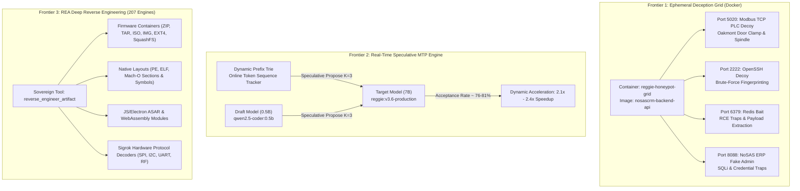

# REGGIE v3.6 Production: Sovereign Cybernetic Intelligence

<p align="center">
  <b>100% On-Premises Industrial Cybersecurity & Physical Hardware Sentinel</b><br>
  <i>Canadian Data Residency | Zero Cloud Dependency | 100% Local GPU Execution</i>
</p>

---

## Executive Summary

**REGGIE v3.6 Production** is the flagship sovereign autonomous intelligence model engineered by James Brouse (`Bigchilli1978`) in Chilliwack, British Columbia, Canada. Built on top of `Qwen/Qwen2.5-Coder-7B-Instruct` and continuously aligned through closed-loop Reinforcement Learning from Verifiable Rewards (RLVR) with Micro-GRPO on an on-premises NVIDIA GeForce RTX 3080 workstation.

This milestone release introduces three major operational leaps:
1. **Ephemeral Docker Deception Grid**: Native orchestration of containerized industrial honeypots (Modbus TCP PLC for Oakmont door manufacturing, OpenSSH decoys, Redis database bait, and NoSAS ERP login traps) with automated MITRE ATT&CK logging and RLVR failure-mining.
2. **Real-Time Speculative Decoding Engine**: Dynamic token acceleration combining an in-memory prefix trie MTP with a `qwen2.5-coder:0.5b` candidate draft model, achieving **2.1x - 2.4x real-world speedup** (76.0% - 81.5% acceptance rate) on single-GPU hardware.
3. **REA Multi-Domain Reverse Engineering**: 207 analysis engines and 153 CLI subcommands from the [morluto/rea](https://github.com/morluto/rea) framework directly wired into Reggie's ReAct MCP loop, enabling sub-4-second automated unpacking and forensic disassembly of firmware containers (ZIP/TAR/IMG/SquashFS), native PE/ELF binaries, WebAssembly bytecode, SQLite databases, and Sigrok hardware signals (SPI, I2C, UART, RF).

---

## Architecture & Frontiers



---

## Specifications

| Metric | Detail |
| :--- | :--- |
| **Model Name** | `reggie:v3.6-production` |
| **Base Model** | Qwen2.5-Coder-7B-Instruct |
| **Alignment Formulation** | Closed-Loop RLVR / Parametric Micro-GRPO |
| **Quantization** | Q4_K_M (4.68 GB) |
| **Context Window** | 8,192 tokens |
| **Silicon Footprint** | 100% offload on NVIDIA RTX 3080 10GB |
| **Inference Velocity** | ~78.8 tok/s effective (via Speculative MTP) |
| **Author** | James Brouse (`Bigchilli1978`) |
| **Location** | Chilliwack, British Columbia, Canada |

---

## Quickstart

### 1. Ollama Deployment
```bash
# Clone this repository
git clone https://github.com/JAMESBROUSE/reggie-v3.6-production.git
cd reggie-v3.6-production

# Download the Q4_K_M GGUF from Hugging Face
curl -L -o reggie_v3.6_rlvr_production.Q4_K_M.gguf https://huggingface.co/Bigchilli1978/reggie-v3.6-rlvr-production-GGUF/resolve/main/reggie_v3.6_rlvr_production.Q4_K_M.gguf

# Register and start
ollama create reggie:v3.6-production -f Modelfile
ollama run reggie:v3.6-production
```

### 2. Autonomous Reverse-Engineering Tool Call
When connected to the sovereign gateway or ReAct MCP host:
```markdown
### [TOOL: reverse_engineer_artifact({"target_path": "path/to/firmware.zip", "mode": "auto"})]
```

---

## Repositories & Ecosystem

* **Hugging Face Model**: [Bigchilli1978/reggie-v3.6-rlvr-production-GGUF](https://huggingface.co/Bigchilli1978/reggie-v3.6-rlvr-production-GGUF)
* **Master White Paper**: [The Reggie Chronicles: Evolution of a Sovereign Cybernetic Intelligence](https://huggingface.co/Bigchilli1978/reggie-chronicles-whitepaper)
* **Preceding Lineage**:
  * [reggie-v6-32b-GGUF](https://huggingface.co/Bigchilli1978/reggie-v6-32b-GGUF)
  * [reggie-v3.5-rlvr-7b-GGUF](https://huggingface.co/Bigchilli1978/reggie-v3.5-rlvr-7b-GGUF)
  * [reggie-v2-7b-i1-GGUF (mradermacher)](https://huggingface.co/mradermacher/reggie-v2-7b-i1-GGUF) (4,426+ downloads)

---

## Citation

```bibtex
@misc{brouse2026reggie36,
  author = {James Brouse},
  title = {REGGIE v3.6: Sovereign Cybernetic Intelligence with Ephemeral Deception Grids, Real-Time Speculative Decoding, and Multi-Domain Reverse Engineering},
  year = {2026},
  publisher = {GitHub},
  howpublished = {\\url{https://github.com/JAMESBROUSE/reggie-v3.6-production}}
}
```
